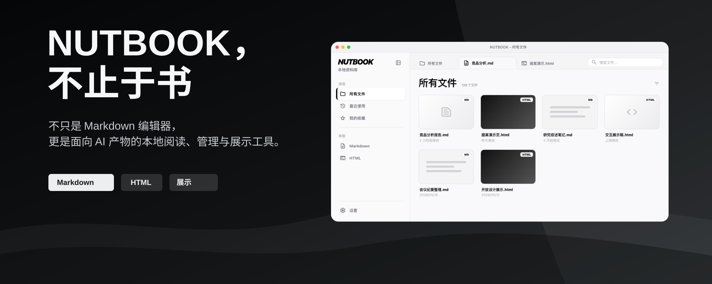
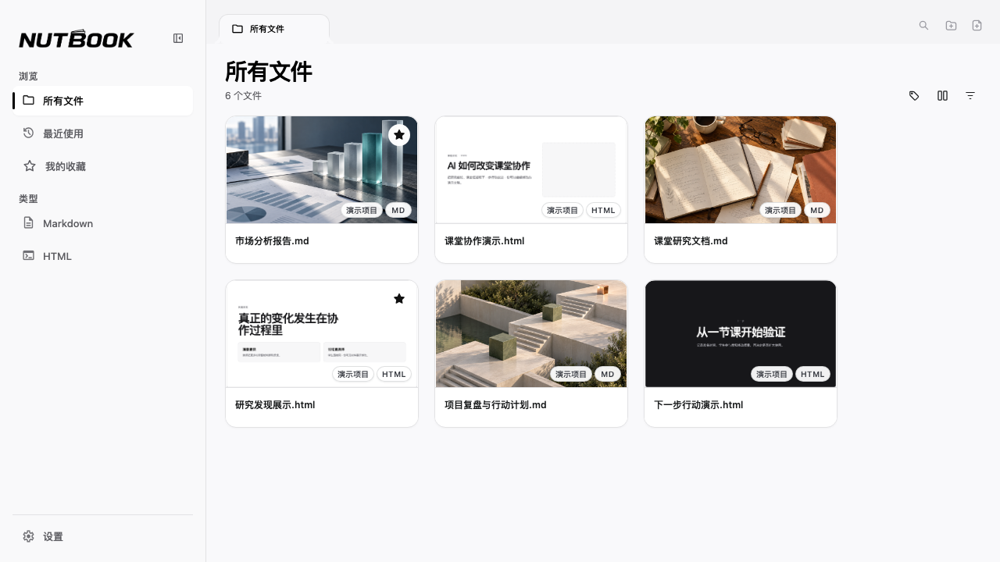
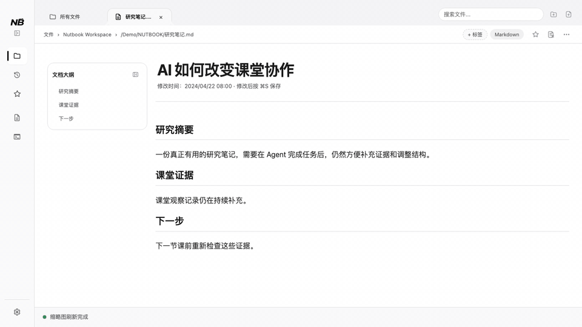
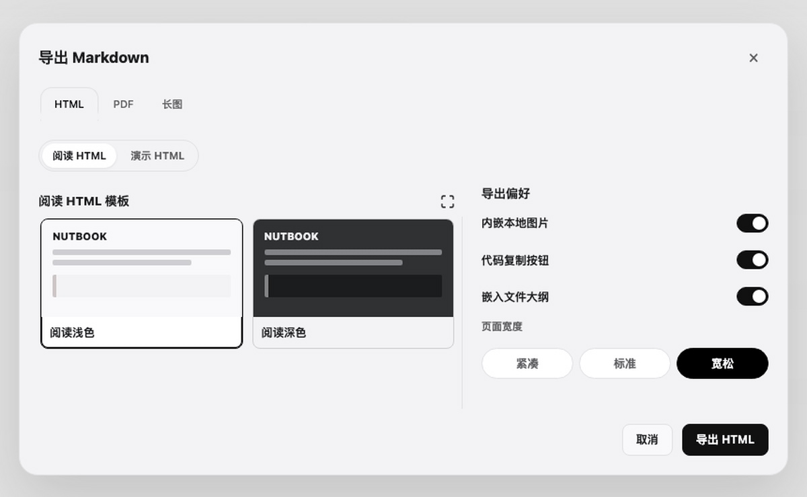
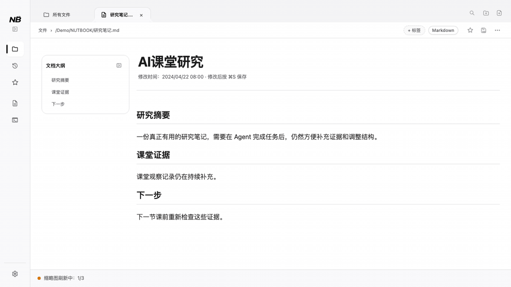
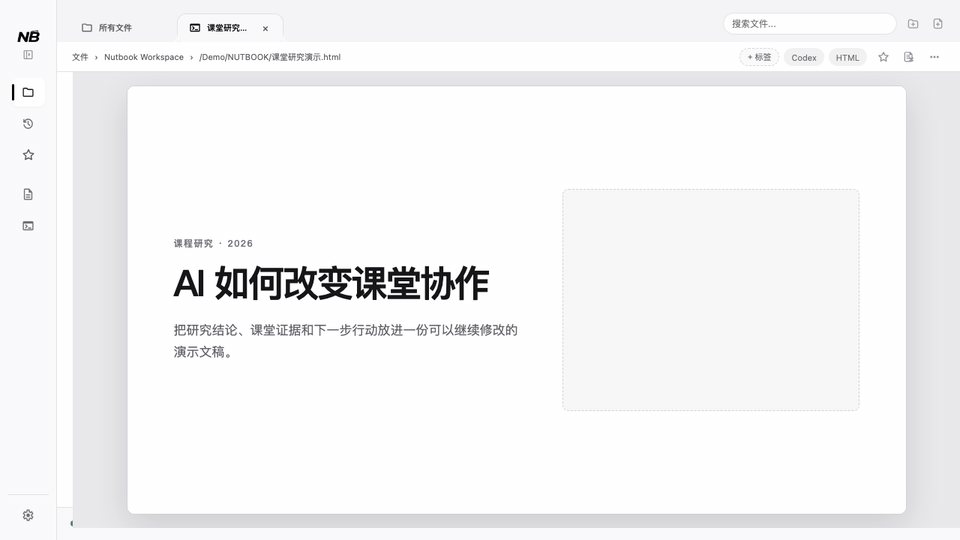
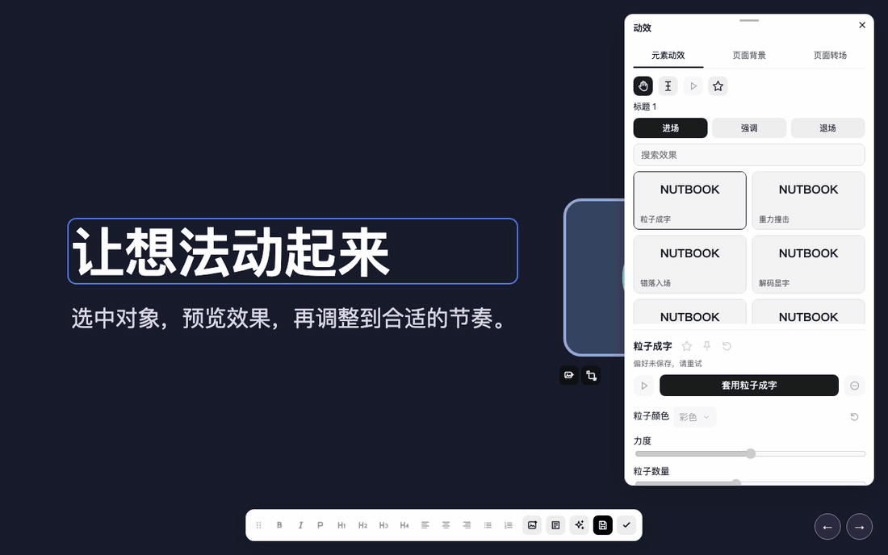
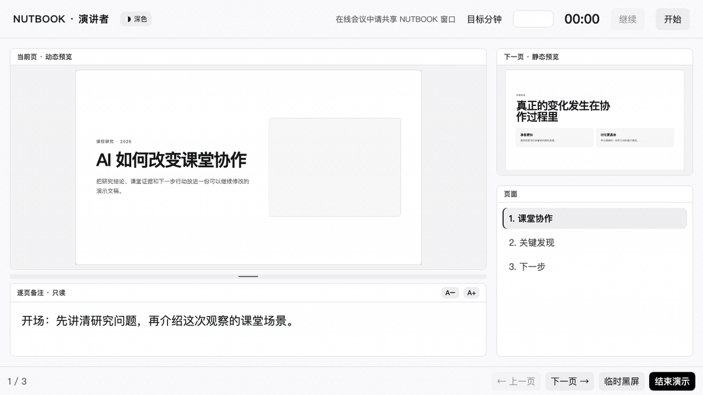
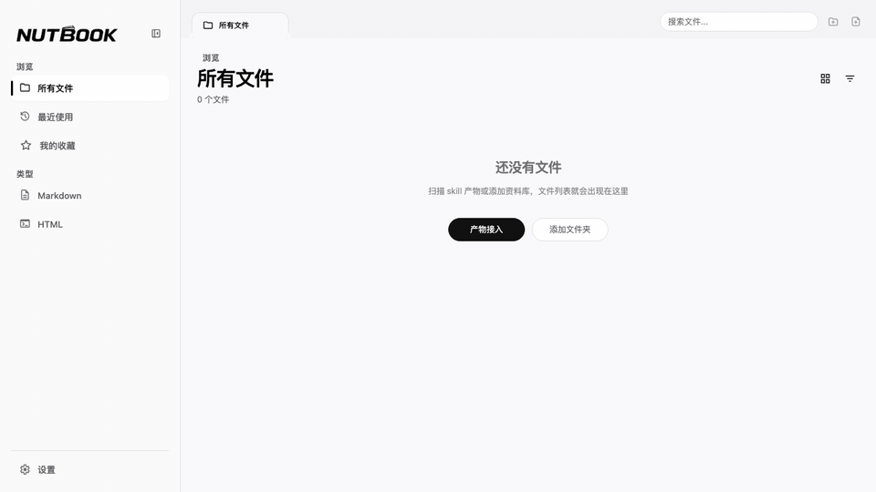

  

# NUTBOOK

**面向 AI 生成内容的本地阅读、管理与展示工具。**

让 AI 生成的文件，成为随时能找到、改得动、用得上的资料。

[下载最新版](https://github.com/Ericonquer/NUTBOOK/releases/latest) · [English](./README.md) · [使用指南](./docs/guides/user-guide-cn.md) · [问题反馈](https://github.com/Ericonquer/NUTBOOK/issues)

<https://github.com/user-attachments/assets/45dcfef4-44c4-4ec1-888a-c47404995a72>

## 这是什么

AI 做好了研究报告、课程资料或演示页，文件却散落在下载目录、项目文件夹和不同 Agent 的任务里。再次使用时，往往还得从头找起。

NUTBOOK 把这些 Markdown 和 HTML 成果汇集到本地资料库。你可以通过封面、标签和来源找到内容，直接阅读和修改，再导出、发布或用于演示。

资料保存在本机，无需上传云端。

### 你可以这样使用

- **教师**：整理教案、课程资料与课堂演示，修改后直接用于教学。
- **研究者与学生**：汇集文献解读、研究笔记和阶段报告，方便查找与持续修订。
- **咨询、策划与商业工作者**：管理调研、竞品分析和客户方案，把成果带进提案与会议。
- **经常使用多个 Agent 的人**：把不同项目和任务生成的资料放在一起，减少翻找对话和目录的时间。

## 核心功能

### 找到和整理资料

添加本地文件、文件夹，或接入 Agent 和 Skill 产出的内容，用缩略图快速认出每份资料。

- 通过搜索、最近使用、收藏、类型和来源筛选内容。
- 为文件添加多个自定义标签，调整顺序，集中管理或批量整理。
- 文件在外部新增、修改或删除后，重新扫描即可同步资料库。

### Markdown：边读边改，按用途输出

阅读时直接修改正文、调整格式、插入图片和表格；配合大纲导航、撤销与重做，把生成的初稿继续完善。

一份 Markdown 可以导出为阅读 HTML、演示 HTML、PDF 或 PNG 长图，也可以另建公众号、X Articles 或微博发布稿，调整排版后预览、复制，或直接发送到平台草稿箱，保留原始文档。

#### 查看导出与排版演示

选择适合交付场景的文件格式：

单独调整发布稿、切换主题，再自动发送到公众号草稿箱：

### HTML：继续修改，也能加上动效

保留 HTML 原有的交互，在受支持的页面中修改文字、调整格式，替换、裁切或移动图片。

打开动效中心，为文字和图片添加进场、强调与退场效果，为页面选择动态背景和转场。可以预览、调整参数与动作顺序，收藏常用效果，并设置自己的默认参数。

普通 HTML 可以创建可编辑副本；支持完整编辑协议的文档可以直接编辑。HTML 编辑面向内容微调，不承担任意页面重构。

### 版本历史：Markdown 和 HTML 都能找回旧版

保存修改时保留文件版本，可预览、恢复或将某个版本另存为新文件。Markdown 支持滚动查看全文；HTML 支持静态预览，演示文件可逐页浏览、输入页码跳转，并在切换版本时保留同一页，方便对照内容。

从文件的“更多 → 版本历史”查看当前文件，在“设置 → 版本历史”集中管理。每个文件最多保留最近 10 个版本，可调整历史总容量；删除原文件后仍可将保留的历史另存到新位置。HTML 历史预览不执行脚本，动态交互不会播放。

### 演示：从文档直接走进课堂和会议

将受支持的 HTML 演示稿用于全屏展示或原生演示模式。观众看内容，你在演讲者界面查看当前页、下一页、逐页备注和计时器。

幻灯片内容、备注和动效设置可以保存，下一次打开继续使用。

## 连接你常用的 Agent

NUTBOOK 支持 **Codex、Claude Code、OpenClaw、Hermes 和 WorkBuddy**，把来自不同项目、任务与 Skill 的成果放进同一个资料库。

在“设置 → 产物接入”中启用检测到的 Agent 集成。之后可以直接对 Agent 说：

> 把这份成果接入 NUTBOOK。

也可以浏览已有项目和任务中的产物，选择需要的内容再接入。不使用 Agent 集成时，仍可直接添加文件或文件夹。

#### 查看 Agent 集成与产物接入演示

## 快速开始

1. 从 [GitHub Releases](https://github.com/Ericonquer/NUTBOOK/releases/latest) 下载适合你的安装包。Mac 用户按 Apple Silicon 或 Intel 选择，Windows 用户选择安装程序。
2. 安装并打开 NUTBOOK，添加一个 Markdown / HTML 文件或文件夹。
3. 若希望持续接收 Agent 成果，进入“设置 → 产物接入”启用集成。
4. 打开资料开始阅读、编辑，或选择需要的导出与演示方式。

首次安装授权、快捷键、缩略图设置和详细操作见 [使用指南](./docs/guides/user-guide-cn.md)。

安装包不内置 Node.js 或浏览器，仅保留约 13 MB 的 Playwright 驱动及发布脚本（未压缩）。**不安装也支持复制草稿到平台**：关闭发送窗口，在预览中复制标题和正文。自动发送会先检查系统 Node.js 22 / 24 与浏览器并检查程序是否可用，已有环境直接复用；缺项时通过“交给 Agent / 手动安装”仅补缺失部分，不会自动下载。没有浏览器时可明确执行安装命令，将 Chromium 安装到共享缓存；X 需要系统 Google Chrome。界面按缺项展示下载量和空间估算，登录资料单独保存，缩略图入口不变。详见 [可选发布环境](./docs/guides/user-guide-cn.md#可选发布环境)。

## 最新版本

### 1.5.0 · 文件版本历史与草稿箱直达

- **最大更新：Markdown / HTML 文件版本历史**。保存时记录版本，支持预览、恢复、另存和集中清理；每个文件最多保留最近 10 个版本，历史总容量可调整。
- **两类文件，分别预览**：Markdown 可滚动阅读全文；HTML 提供静态预览，演示文件支持逐页翻看、输入页码跳转和跨版本同页对照。
- **直接发送草稿箱**：Markdown 排版后的发布稿可发送到公众号、微博和 X 草稿箱；优先复用兼容的系统 Node.js 与浏览器，按需补齐发布环境。
- **演示备注随时调整**：演讲者窗口内可编辑、保存当前页备注，并纳入文件版本历史。
- **修复与稳定性**：修复 nbskill 产物接入等历史问题，改进文件保存、恢复、更新交付和预览体验。

### 历史版本

- **1.4.0**：有序多标签、动效中心、动态背景与页面转场。
- **1.3.0**：Markdown 排版中心、独立平台发布稿与自定义工具栏。
- **1.2.0**：HTML 原生演示模式、演讲者界面与逐页备注。
- **1.1.0**：Markdown 导出中心，支持 HTML、PDF 和 PNG 长图。
- **1.0.0**：本地资料接入、Markdown / HTML 阅读轻编辑与系统打开。
- **0.8.0**：Agent 项目与任务产物发现、nbskill 集成与 Nutbook CLI。
- **0.6.0**：HTML 文字与图片轻编辑，支持保存与重开。

## 文档与贡献

- [使用指南](./docs/guides/user-guide-cn.md)：安装、资料接入、快捷键与常见问题。
- [开发指南](./docs/guides/development-cn.md)：源码运行、构建、检查与 Nutbook CLI。
- [发布流程](./docs/guides/releasing-cn.md)：PR 检查、版本 tag、安装包与 Release。
- [反馈问题或建议](https://github.com/Ericonquer/NUTBOOK/issues) · [参与贡献](https://github.com/Ericonquer/NUTBOOK/pulls)

NUTBOOK 聚焦个人本地资料的阅读、轻编辑、管理与展示，目前不提供云同步、在线协作或 RAG。

## License

NUTBOOK is licensed under the Apache License 2.0. See [LICENSE](./LICENSE) for details.

Third-party dependency notices are listed in [THIRD\_PARTY\_LICENSES.md](./THIRD_PARTY_LICENSES.md).
