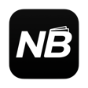
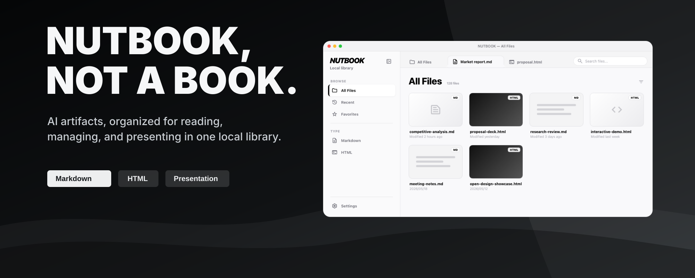
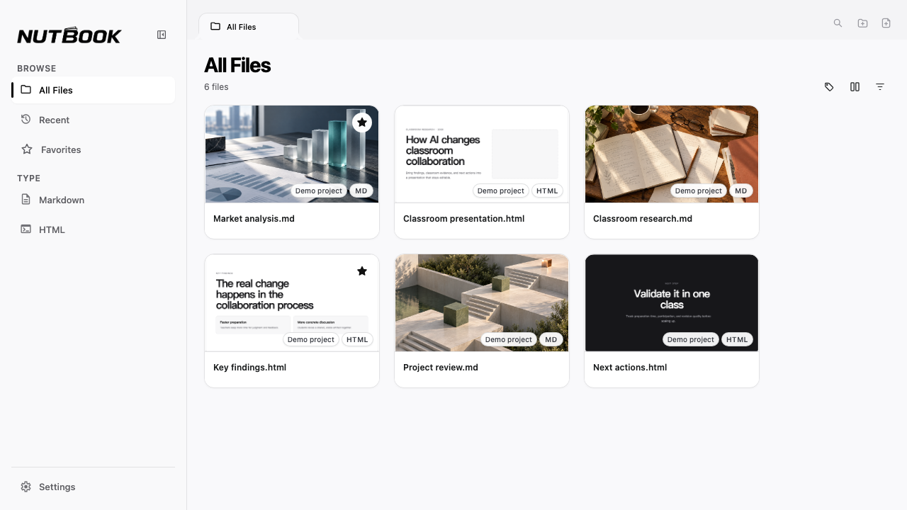
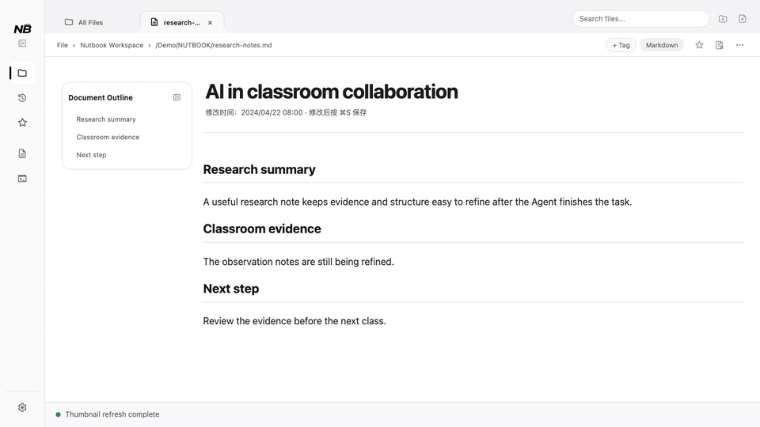
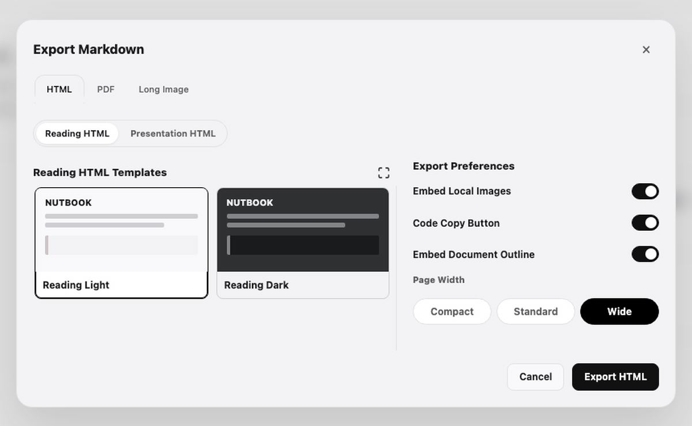
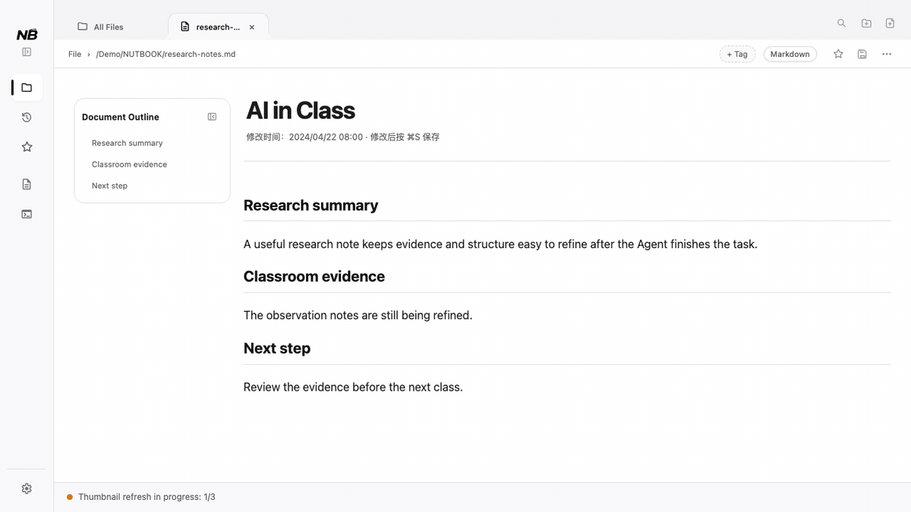
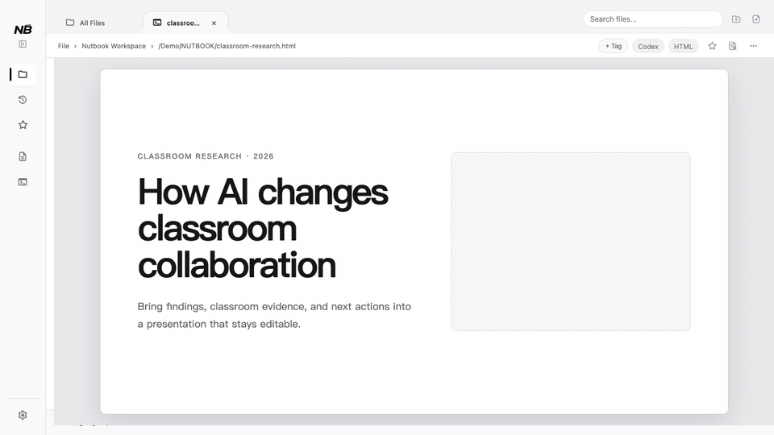
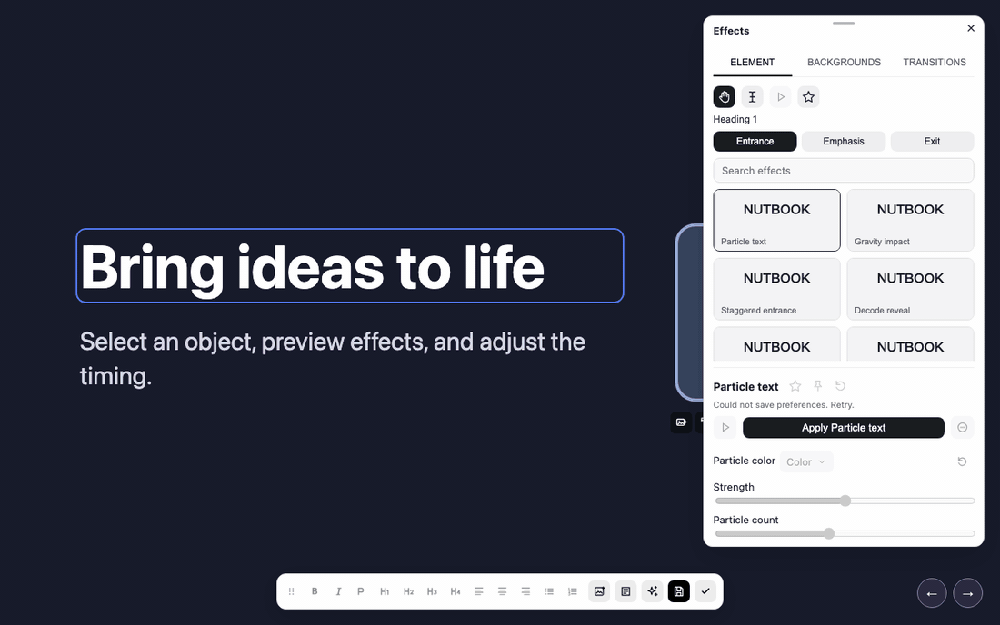
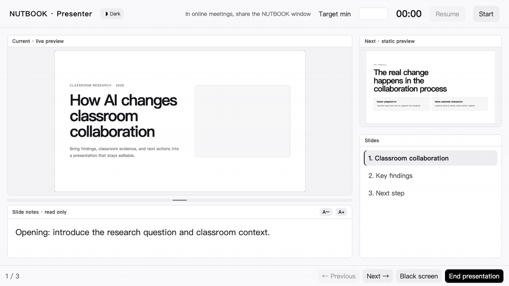
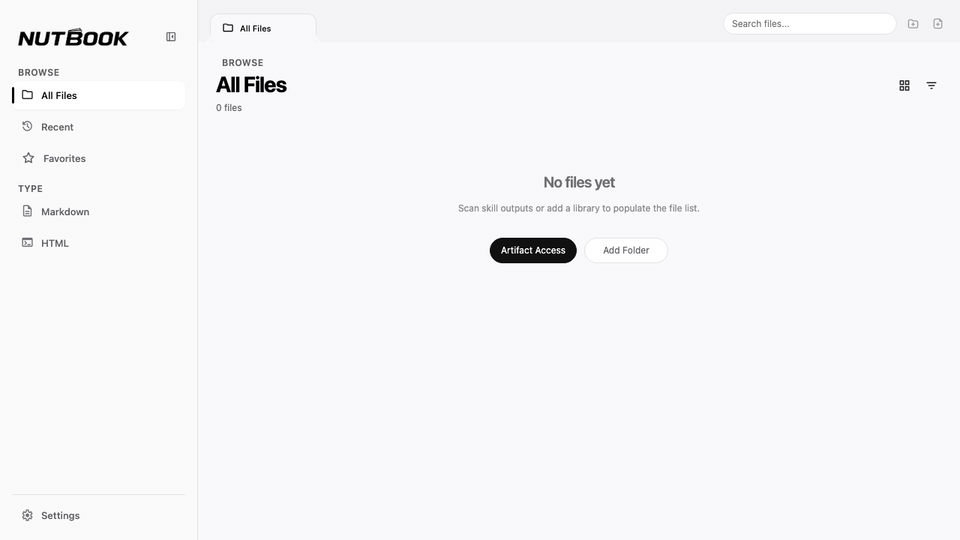

  

# NUTBOOK

**A local tool for reading, managing, and presenting AI-generated content.**

Turn generated files into useful materials you can find, refine, and reuse.

[Download](https://github.com/Ericonquer/NUTBOOK/releases/latest) · [中文版](./README-CN.md) · [User guide](./docs/guides/user-guide.md) · [Report an issue](https://github.com/Ericonquer/NUTBOOK/issues)

<https://github.com/user-attachments/assets/45dcfef4-44c4-4ec1-888a-c47404995a72>

## What Is NUTBOOK?

AI delivers research reports, teaching materials, and presentations, but the files often end up scattered across downloads, project folders, and Agent tasks. Finding them again takes work.

NUTBOOK brings Markdown and HTML outputs into a local library. Find content by its cover, tags, or source; read and refine it; then export, publish, or present it.

Your files stay on your computer without uploading them to a cloud service.

### Ways to Use It

- **Teachers**: organize lesson plans, course materials, and presentations, then refine them for class.
- **Researchers and students**: collect literature reviews, research notes, and reports for reference and ongoing revision.
- **Consultants, planners, and business teams**: manage research, competitive analysis, and proposals for meetings and client presentations.
- **People working with multiple Agents**: keep outputs from different projects and tasks together instead of searching through old conversations and folders.

## Core Features

### Find and Organize Materials

Add local files and folders, or connect outputs from Agents and Skills. Recognize each document by its thumbnail.

- Search and filter by recent use, favorites, type, and source.
- Add multiple custom tags, change their order, and organize documents in batches.
- Rescan your library to pick up files added, changed, or deleted elsewhere.

### Markdown: Refine While Reading, Export for Your Audience

Edit text, adjust formatting, and insert images or tables while reading. Outline navigation, undo, and redo help you turn an initial draft into something ready to use.

Export Markdown as reading HTML, presentation HTML, PDF, or a PNG long image. You can also create separate WeChat, X Articles, or Weibo publishing drafts, adjust their layout, then preview, copy, or send them directly to the platform’s draft box while keeping the original document.

#### Watch export and publishing demos

Choose the format that suits your delivery:

Adjust a separate publishing draft, switch themes, and send it directly to WeChat drafts:

### HTML: Keep Editing, Add Motion

Keep the page's original interactions while editing supported text, formatting, and images. Replace, crop, or reposition images when needed.

Use the Motion Center to add entrances, emphasis, and exits to text and images, plus animated backgrounds and page transitions. Preview effects, adjust parameters and action order, favorite effects, and set your own defaults.

Ordinary HTML can be opened as an editable copy; documents with the full editing contract support direct editing. HTML editing focuses on content adjustments rather than rebuilding arbitrary pages.

### Version History for Markdown and HTML

Keep saved versions of your files, preview earlier content, restore it, or save a version as a new file. Markdown supports full-document scrolling. HTML provides static previews; presentations support page navigation, direct page-number entry, and keeping the same page selected across versions for comparison.

Open **More → Version history** for the current file, or manage files together in **Settings → Version history**. Keep up to 10 recent versions per file with an adjustable total storage limit. Retained history can be saved to a new location even after the original file is deleted. HTML history previews do not execute scripts or play dynamic interactions.

### Present in Class and Meetings

Open supported HTML decks fullscreen or in native presentation mode. Your audience sees the slides while you see the current slide, next-slide preview, per-slide notes, and timer.

Save slide content, notes, and motion settings, then pick up where you left off next time.

## Connect Your Agents

NUTBOOK supports **Codex, Claude Code, OpenClaw, Hermes, and WorkBuddy**, bringing outputs from different projects, tasks, and Skills into one library.

Enable a detected Agent integration in **Settings → Artifact Access**, then tell your Agent:

> Add this artifact to NUTBOOK.

You can also browse existing project and task outputs and choose what to add. Local files and folders work without Agent integrations.

#### Watch Agent integration and artifact access

## Quick Start

1. Download an installer from [GitHub Releases](https://github.com/Ericonquer/NUTBOOK/releases/latest). Choose Apple Silicon or Intel for your Mac, or the Windows installer.
2. Install NUTBOOK and add a Markdown / HTML file or folder.
3. To keep receiving Agent outputs, enable an integration in **Settings → Artifact Access**.
4. Open your materials to read, edit, export, or present them.

See the [user guide](./docs/guides/user-guide.md) for first-launch authorization, shortcuts, thumbnail settings, and detailed instructions.

The installer bundles no Node.js or browser, only the Playwright driver and publishing scripts (about 13 MB uncompressed). **You can copy drafts into your platform without installing anything.** Automatic delivery first checks system Node.js 22 / 24 and inspects an existing browser without launching it; compatible tools are reused. If tools are missing, **Ask your agent / Install manually** guides setup of only the missing items; nothing downloads automatically. Explicit setup can install missing Chromium into the shared cache. X needs system Google Chrome. Download and disk estimates depend on the missing items; login profiles stay separate and thumbnail setup is unchanged. See [optional publishing tools](./docs/guides/user-guide.md#optional-publishing-tools).

## Latest Version

### 1.5.1 · Windows Compatibility and Resource Reliability

- Fix Windows file cards, local Markdown images, native HTML opening, and GUI/CLI startup conflicts.
- Preserve archived images using bounded native resource sessions and compact preview paths, with cleanup on close.
- Add Windows application and protocol regression gates; candidate installers are validated separately from normal PR checks.

### Earlier Releases

- **1.5.0**: Markdown / HTML file history, direct draft delivery, and editable presenter notes.
- **1.4.0**: Ordered multi-tags, Motion Center, animated backgrounds, and page transitions.
- **1.3.0**: Markdown publishing workspace, separate platform drafts, and customizable toolbar.
- **1.2.0**: Native HTML presentations, presenter view, and per-slide notes.
- **1.1.0**: Markdown export to HTML, PDF, and PNG long images.
- **1.0.0**: Local intake, Markdown / HTML reading and light editing, and system file opening.
- **0.8.0**: Agent project and task discovery, nbskill integration, and Nutbook CLI.
- **0.6.0**: HTML text and image editing with save and reopen support.

## Documentation and Contributing

- [User guide](./docs/guides/user-guide.md): installation, intake, shortcuts, and common questions.
- [Development guide](./docs/guides/development.md): source builds, checks, and Nutbook CLI.
- [Release process](./docs/guides/releasing.md): PR checks, version tags, installers, and Releases.
- [Issues and suggestions](https://github.com/Ericonquer/NUTBOOK/issues) · [Contribute](https://github.com/Ericonquer/NUTBOOK/pulls)

NUTBOOK focuses on reading, lightly editing, managing, and presenting personal local materials. Cloud sync, online collaboration, and RAG are not currently supported.

## License

NUTBOOK is licensed under the Apache License 2.0. See [LICENSE](./LICENSE) for details.

Third-party dependency notices are listed in [THIRD\_PARTY\_LICENSES.md](./THIRD_PARTY_LICENSES.md).
